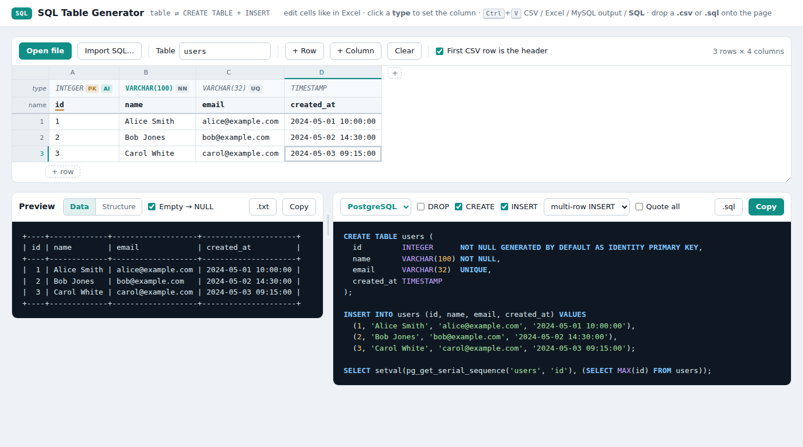

# SQL Table Generator

[](https://github.com/master2sid2/sql-table-generator/actions/workflows/ci.yml)
[](https://github.com/master2sid2/sql-table-generator/releases)
[](go.mod)
[](LICENSE)

Design a table in a spreadsheet-like editor and get the SQL to create it —
`CREATE TABLE` and `INSERT` for **MySQL / MariaDB, PostgreSQL, SQLite or
SQL Server**. Or go the other way: paste `CREATE TABLE` / `INSERT`, a
`mysqldump`, `pg_dump`, SSMS or `sqlite3 .dump` script, and get the table back
in the editor — which also converts a table from one database to another.

```sql
CREATE TABLE users (
  id         INTEGER      NOT NULL GENERATED BY DEFAULT AS IDENTITY PRIMARY KEY,
  name       VARCHAR(100) NOT NULL,
  email      VARCHAR(32)  UNIQUE,
  created_at TIMESTAMP
);

INSERT INTO users (id, name, email, created_at) VALUES
  (1, 'Alice Smith', 'alice@example.com', '2024-05-01 10:00:00'),
  (2, 'Bob Jones', 'bob@example.com', '2024-05-02 14:30:00');

SELECT setval(pg_get_serial_sequence('users', 'id'), (SELECT MAX(id) FROM users));
```



It is a single binary with the web interface built in. Everything runs
locally: the page loads nothing from the internet and your data never leaves
your machine.

> Looking for the tool that turns data into a text table like the `mysql`
> client prints (`+----+-------+`) for tickets and chats? It is
> [ascii-table-generator](https://github.com/master2sid2/ascii-table-generator);
> its versions v0.1.0 and v0.2.0 were published under this name by mistake.

## Install

```bash
go install github.com/master2sid2/sql-table-generator@latest
```

Or download a binary for Linux, macOS or Windows from the
[releases](https://github.com/master2sid2/sql-table-generator/releases) page,
or build from source (see [Build](#build)).

## Usage

```bash
sql-table-generator                       # http://127.0.0.1:8080
sql-table-generator -addr 127.0.0.1:9000  # another address
sql-table-generator -version
```

Then open the address in a browser.

## Features

- **Spreadsheet-like editor**: column names in the first row, data below.
  Cells behave as in Excel: click, drag or `Shift`+arrows to select, type or
  double-click / `F2` to edit, `Enter` / `Tab` to move, `Delete` to clear,
  `Ctrl+Z` / `Ctrl+Y` to undo and redo, `Ctrl+C` / `Ctrl+X` / `Ctrl+V` with
  Excel and Google Sheets.
- **Column types**: the `type` row shows the type of each column. It is
  inferred from the data (`INT`, `BIGINT`, `DECIMAL(p,s)`, `BOOLEAN`, `DATE`,
  `DATETIME`, `UUID`, `JSON`, `VARCHAR(n)` …) until you set one. Click it (or
  press `F4`) to set the type, length, primary key, auto increment,
  `NOT NULL`, unique, default, comment and a **foreign key**: the table and
  column it references (`customer_id` suggests `customers`) with
  `ON DELETE` / `ON UPDATE` actions. It becomes
  `CONSTRAINT fk_orders_customer_id FOREIGN KEY (customer_id) REFERENCES customers (id)`;
  SQL Server gets `NO ACTION` for `RESTRICT`, which it does not have, and
  SQLite a reminder that it checks keys only after `PRAGMA foreign_keys = ON`.
- **SQL for four dialects**, switched with one list: types, identity columns,
  quoting and literals follow the database:

  | Column | MySQL | PostgreSQL | SQLite | SQL Server |
  |---|---|---|---|---|
  | auto increment | `AUTO_INCREMENT` | `GENERATED BY DEFAULT AS IDENTITY` | `PRIMARY KEY AUTOINCREMENT` | `IDENTITY(1,1)` |
  | text | `VARCHAR(n)` | `VARCHAR(n)` | `VARCHAR(n)` | `NVARCHAR(n)`, `N'…'` literals |
  | boolean | `BOOLEAN` | `BOOLEAN` | `BOOLEAN` (0/1) | `BIT` |
  | date and time | `DATETIME` | `TIMESTAMP` | `DATETIME` | `DATETIME2` |
  | JSON / UUID | `JSON` / `CHAR(36)` | `JSONB` / `UUID` | `TEXT` | `NVARCHAR(MAX)` / `UNIQUEIDENTIFIER` |
  | reserved names | `` `order` `` | `"order"` | `"order"` | `[order]` |

  Options: `DROP TABLE IF EXISTS`, `CREATE TABLE`, `INSERT` (multi-row, split
  every 1000 rows, or one statement per row), quote every identifier, empty
  cells as `NULL`. Explicit ids in an identity column get
  `SET IDENTITY_INSERT` in SQL Server and a `setval(...)` in PostgreSQL; an
  identity column without values is left to the database. Things a dialect
  cannot express come out as warnings above the SQL.
- **Preview**: the data as the `mysql` client prints it, or the structure as
  `DESCRIBE` shows it (with a `References` column for foreign keys). Drag the
  line between the preview and the SQL to share the width differently
  (double-click resets it); the share is remembered.
- **SQL → table**: paste SQL into the grid or into *Import SQL…*, or open or
  drop a `.sql` file. Understood: `CREATE TABLE` with column and table
  constraints, `INSERT` / `REPLACE` (with or without a column list, without
  semicolons as SSMS writes them), PostgreSQL `COPY … FROM stdin`, and the
  `ALTER TABLE … ADD PRIMARY KEY / FOREIGN KEY / MODIFY / SET DEFAULT` and
  `COMMENT ON COLUMN` statements dumps keep keys and comments in. Foreign
  keys are read in every form (inline `REFERENCES`, table constraints,
  pg_dump's and SSMS's `ALTER TABLE`); keys over several columns are kept and
  written back, though the editor does not edit them. When a script has
  several tables, the first one is loaded; indexes and checks are skipped.
- **Other input**: CSV, TSV (`,` `;` `Tab` `|` detected; UTF-8, UTF-16 or
  Windows-1251), `mysql` client tables, `\G` output, and `DESCRIBE` / psql
  `\d` output, which becomes the column definitions.
- **Copy** or **download** the SQL (`.sql`) and the preview (`.txt`).
- The current draft is kept in the browser's `localStorage`.

## Security

The server listens on `127.0.0.1` by default. It has no authentication, so
only bind it to another address (`-addr 0.0.0.0:8080`) on a network you trust.
Requests are limited to 20 MiB.

## API

The web page uses a small JSON API, which can be used directly:

| Method | Path | Body → response |
|---|---|---|
| `POST` | `/api/generate` | `{"table":{"headers":[],"rows":[[]]},"columns":[{...}],"options":{...}}` → `{"sql","preview","structure","columns","warnings"}` |
| `POST` | `/api/parse` | `{"text":"...","format":"auto","header":true}` → `{"headers","rows","format","hasHeader","columns","tableName","dialect","notes"}` |
| `POST` | `/api/upload` | multipart form: `file`, `format`, `header` → same as `/api/parse` |

A column: `type` (empty for inferred, or `int`, `bigint`, `smallint`,
`decimal`, `float`, `bool`, `varchar`, `char`, `text`, `date`, `time`,
`datetime`, `json`, `uuid`, `blob`), `length`, `scale`, `pk`, `ai`,
`notNull`, `unique`, `default`, `comment`, `ref` (a foreign key:
`{"table","column","onDelete","onUpdate","name"}`). Keys over several columns
go in `foreignKeys`: `[{"columns":[],"table","refColumns":[],"onDelete","onUpdate","name"}]`.

`options`: `dialect` (`mysql`, `postgres`, `sqlite`, `mssql`), `table`,
`create`, `drop`, `insert`, `insertMode` (`multi`, `single`), `quoteAll`,
`emptyAsNull`. `format`: `auto`, `sql`, `csv`, `tsv`, `mysql`, `pipe`,
`vertical`.

Errors come back as `{"error":"..."}` with status `400`, `413` or `422`.

```bash
curl -s localhost:8080/api/generate -d '{"table":{"headers":["id","name"],"rows":[["1","Alice"]]},
  "columns":[{"pk":true}],"options":{"dialect":"sqlite","create":true,"insert":true}}'
```

## Build

Requires Go 1.26+.

```bash
make build       # bin/sql-table-generator, version taken from the VERSION file
make test        # unit tests
make lint        # go vet and gofmt check
make install     # copy to /usr/local/bin (PREFIX=... to change)
make dist        # release binaries for Linux, macOS and Windows in dist/
make screenshot  # refresh docs/screenshot.png (Node.js, Playwright)
```

Releases on GitHub are built by [GoReleaser](https://goreleaser.com) in GitHub
Actions when a `v*` tag is pushed; the tag must match the `VERSION` file.

## Layout

```
main.go              flags, HTTP server, graceful shutdown
handlers.go          JSON API
version.go           version information
internal/sqlgen/     type inference, SQL generation per dialect, SQL import (lexer, parser)
internal/table/      CSV/TSV/mysql-output parsing, text table rendering, widths, encodings
web/                 the page, embedded into the binary
```

## License

[MIT](LICENSE)
